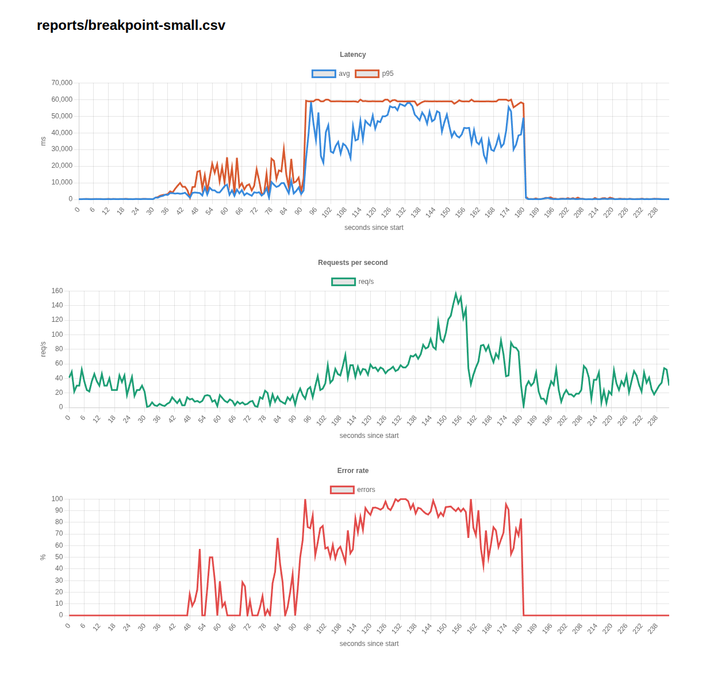
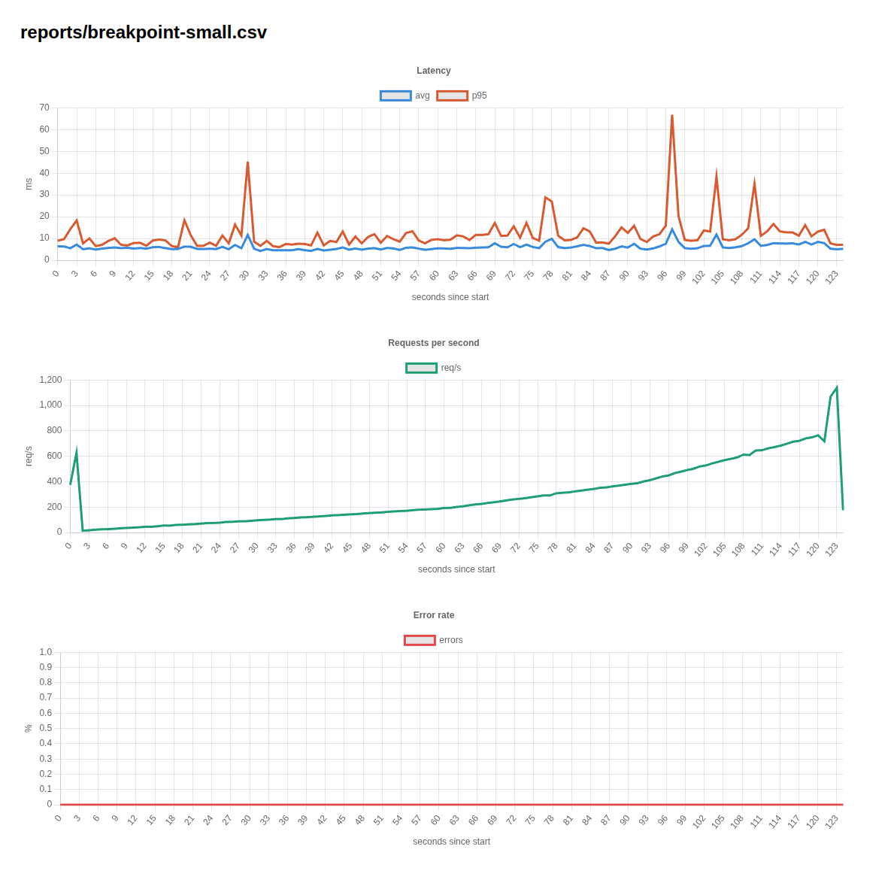

# Pagination

**Definition:** Pagination is the process of dividing a large dataset into smaller, manageable chunks (pages) instead of retrieving the entire dataset in a single request.

## Before

**Commit:** [8d60aac](https://github.com/theSolution12/Opt/commit/8d60aac75a15062b09c4136f878ab4dbe2e9d5c5)

## After

**Commit:** [ae501f7](https://github.com/theSolution12/Opt/commit/ae501f71b45fe8a2a4b89ecd85db7f8f3cba9900)

## Explanation

Previously, the GET endpoint retrieved the entire users dataset in a single request (bulk retrieval).

After the change, the endpoint retrieves a limited subset of users using `index` and `pageSize` as request parameters.

This reduces the amount of data processed and transferred per request, making the endpoint more manageable under concurrent load.
